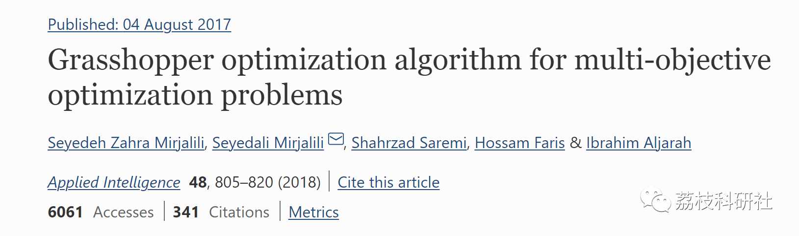
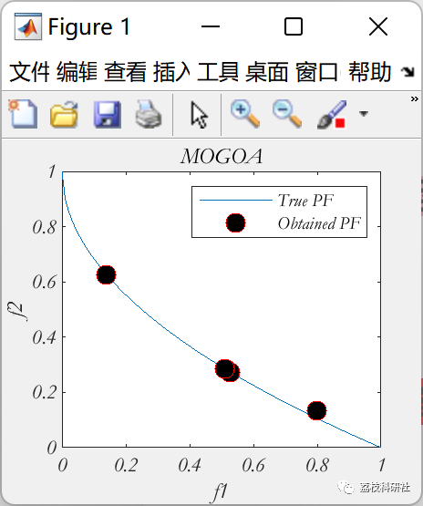

# Multi-objective Optimization Grasshopper Optimization Algorithm (Matlab Code Implementation)

💥💥💥💞💞💞 Welcome to this blog❤️❤️❤️ 💥💥💥
🏆 Bloggers' Advantage: 🌞🌞🌞 The content of the blog strives for rigorous thinking and clear logic, making it convenient for readers.
⛳️ Mantra: A journey of a thousand miles is begun with a single step.
Litchi Research Society
Code Collection: Power Systems, Intelligent Algorithms and Applications, Neural Network Prediction, Path Planning, Optimized Scheduling, Workshop Scheduling, Image Processing, Signal Processing...
🎁 Special Section Links:
🌈🌈🌈🌟🌟🌟🌟 Electrical Code Intelligent Algorithms and Their Applications Path Planning Neural Network Prediction Optimized Scheduling Image Processing Workshop Scheduling Signal Processing Romantic Her
💥1 Overview
This work proposes a new multi-objective algorithm inspired by the navigation of grasshoppers in nature. It first uses mathematical models to simulate the interactions among individuals in swimming, including attraction, repulsion, and comfort zones. Then, a mechanism is proposed to approximate the global optimal value in a single-objective search space using the model. Subsequently, archive and target selection techniques are integrated into the algorithm to estimate the Pareto optimal frontier of multi-objective problems. To benchmark the performance of the proposed algorithm, a set of different standard multi-objective test problems were utilized. Results were compared with the most popular and state-of-the-art algorithms in the evolution of multi-objective optimization literature using three performance metrics quantitatively and qualitatively. The results indicate that the proposed algorithm can provide highly competitive results in terms of precision and distribution of the obtained Pareto optimal solutions.
📚2 Running Results
🎉3 References
🌈4 MATLAB Code Implementation
Click the article's lower left corner to read more.

## Images

<!-- PAYMENT_BLOCK -->

## Get this dataset

- Payment link (Stripe): [Buy now](https://buy.stripe.com/3cs8yP7sY87d0vu9AB)
- Payment QR code: 

<!-- /PAYMENT_BLOCK -->
